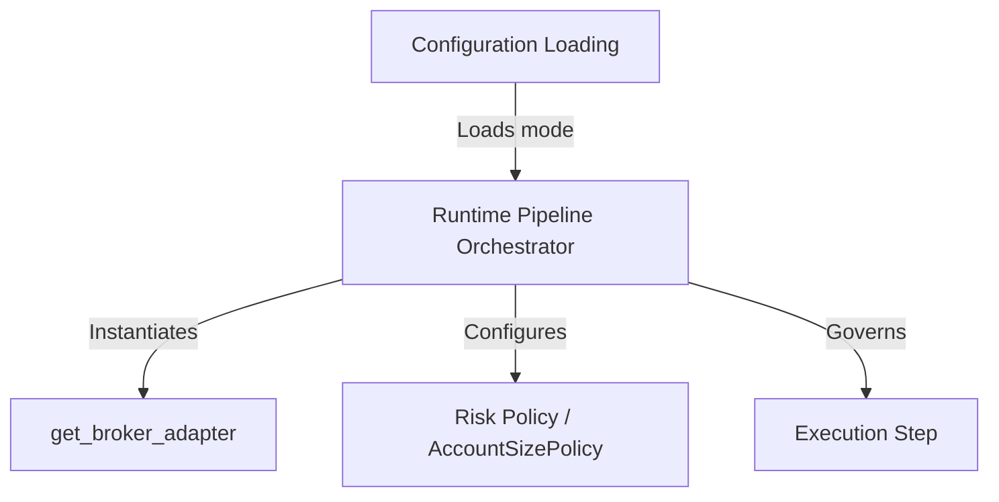

# PRD: R5.4 Mode Flag (paper | propose-only | live) — One-Line Flip

## Ownership

Owner: Ours

Source note: The execution layer must govern all system environments via a single, centralized execution mode flag: `paper | propose-only | live`. Changing this single flag must adapt the behavior of the broker adapter, risk gatekeeper, and runtime pipeline safely, preventing accidental live trading during dry-runs or tests.

---

## Objective

Define the design, configuration schemas, propagation flows, behavioral matrix, and strict safety safeguards for the execution mode flag (`ExecutionMode`) across the Prescient system.

R5.4 answers:
```text
How can the system dynamically switch between paper, propose-only, and live execution modes via a single configuration line while guaranteeing that no orders are placed under propose-only, sandbox API endpoints are used for paper, and strict real-money safeguards are enforced for live?
```

---

## Background

To run an autonomous trading strategy safely, developer operations require distinct execution environments:
1. **propose-only**: A dry-run environment. The system queries the real-time live account cash, buying power, and positions to generate proposed trades but **stops short of sending any order requests** to the broker. This allows strategy testing and manual validation on actual portfolio states without taking financial risk.
2. **paper**: A simulated sandbox environment. The system connects to the broker's virtual/paper endpoints (e.g., Alpaca paper API), performing full end-to-end execution including position sizing, risk checks, and trade execution using virtual money.
3. **live**: A real-money environment. The system connects to live broker endpoints, executing trades using real cash and enforcing strict account restrictions (such as account size limits).

Hardcoding URLs, flags, or having separate configuration toggles for paper endpoints versus real execution creates a high risk of human error (e.g., accidentally placing a real trade during a test run due to a misconfigured Boolean). 

A centralized, single-line configuration flag (the "one-line flip") guarantees that the entire pipeline operates with consistent, safe behavior.

---

## Technical Architecture & Requirements

### R5.4.1 Configuration Flag ("One-Line Flip")

The system's execution mode is governed by a unified config parameter `execution_mode`, which maps to the existing `ExecutionMode` enum:

```python
class ExecutionMode(StrEnum):
    PAPER = "paper"
    PROPOSE_ONLY = "propose_only"
    LIVE = "live"
```

1. **Config File Schema (`config.yaml` or `.env`)**:
   The primary source of truth must be the `EXECUTION_MODE` environment variable or the `broker.execution_mode` config field:
   ```yaml
   # config.yaml
   broker:
     name: "alpaca"
     execution_mode: "propose_only"  # Choices: "paper", "propose_only", "live"
   ```
   Or in `.env`:
   ```bash
   EXECUTION_MODE=propose_only
   ```
2. **Safe-by-Default Fallback**:
   If the configuration is missing or invalid, the system must default to `ExecutionMode.PROPOSE_ONLY` to prevent accidental trade placement.

---

### R5.4.2 Configuration Propagation Flow

At startup, the runtime engine/orchestrator loads the configured mode and propagates it to all downstream systems:



1. **Broker Adapter Initialization**:
   - The factory `get_broker_adapter(broker_name, execution_mode)` instantiates the selected adapter.
   - The adapter uses `execution_mode` to resolve base URLs and API configurations (e.g., routing to Alpaca's paper API for `ExecutionMode.PAPER`, or live API for `ExecutionMode.LIVE`/`ExecutionMode.PROPOSE_ONLY`).
2. **Risk Gatekeeper Initialization**:
   - The risk gatekeeper uses `execution_mode` to determine eligibility. For example, live trading may require strict account size audits (R3.8), which are waived or warned in paper mode.

---

### R5.4.3 Mode Behavioral Matrix

| Feature / Behavior | `ExecutionMode.PROPOSE_ONLY` | `ExecutionMode.PAPER` | `ExecutionMode.LIVE` |
| :--- | :--- | :--- | :--- |
| **API Endpoints** | Live endpoints (read-only queries) | Sandbox/Paper endpoints | Live endpoints (read/write) |
| **Account Snapshot** | Queries real live cash / equity | Queries paper cash / equity | Queries real live cash / equity |
| **Positions & Orders Query** | Queries real live portfolio | Queries paper portfolio | Queries real live portfolio |
| **Order Placement** | **Blocked at runner level**. Returns mock success with status `propose_only` | Allowed. Submits virtual order to broker | Allowed. Submits real order to broker |
| **Risk Check Enforcement** | Strict calculations, but failure triggers warnings/proposals | Full validation on virtual values | Strict validation. Failures block execution |
| **Account Policy Check** | Eligible (warns on size violations) | Eligible (warns on size violations) | Strict block if size is outside $10k-$25k |
| **Journal / Output Logging** | Logs trade proposals only | Logs executed paper trades | Logs executed live trades |

---

### R5.4.4 Safety Safeguards & Execution Rails

To prevent accidental real-money losses, the runtime and adapter layers must enforce the following safety checks:

1. **Propose-Only Order Intercept**:
   - The pipeline executor must verify `execution_mode` before invoking `BrokerAdapter.place_order()`.
   - If the mode is `ExecutionMode.PROPOSE_ONLY`, the runner must bypass the adapter's order placement method entirely, returning a virtual `OrderExecutionResult` with `BrokerOrderStatus.OPEN` (or a specific `PROPOSAL` status) and writing it to the pipeline journal as a dry-run proposal.
   - If the concrete `BrokerAdapter` receives a `place_order` call while initialized under `ExecutionMode.PROPOSE_ONLY`, it must throw a `BrokerExecutionError` or `ConfigurationError` to prevent network transmission.

2. **Live Execution Banners**:
   - If `execution_mode` is `ExecutionMode.LIVE`, the system must print a highly visible, colored terminal banner during initialization:
     ```text
     ============================================================
     !! WARNING: LIVE REAL-MONEY TRADING MODE IS ACTIVE !!
     ============================================================
     ```
   - For `propose_only` and `paper`, the system must print clear indicator messages showing the risk-free status.

3. **Capability Violations**:
   - If a broker adapter does not support paper trading (e.g. Robinhood today), configuring `ExecutionMode.PAPER` must throw a `ConfigurationError` during adapter factory construction, rather than silently falling back to live trading.

---

## Acceptance Criteria

1. **Centralized Configuration**: Changing `EXECUTION_MODE` in the configuration/environment propagates correctly and alters the behavior of both the broker adapter and risk gatekeeper.
2. **Propose-Only Order Prevention**: Under `PROPOSE_ONLY` mode, any pipeline run generates candidate decisions and trade sizing proposal logs, but zero order placement API calls are transmitted over the network.
3. **Paper Sandbox Routing**: Under `PAPER` mode, broker connection queries are routed to paper/sandbox endpoints (e.g. `paper-api.alpaca.markets`), and positions list virtual holdings.
4. **Live Guardrails Enforced**: Under `LIVE` mode, the system connects to the production broker endpoints and strictly enforces live account restrictions (e.g. account size limits).
5. **No Invalid Fallbacks**: Configuring `PAPER` mode on an adapter without sandbox capabilities raises a startup error immediately.

---

## Non-Goals

- Simulating fill rates, partial fills, or slippage inside the runtime for `propose_only` mode.
- Supporting multiple active execution modes concurrently within the same pipeline run.
